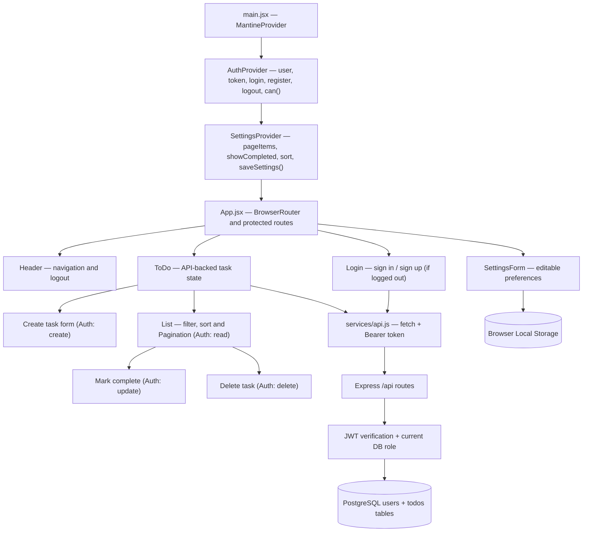
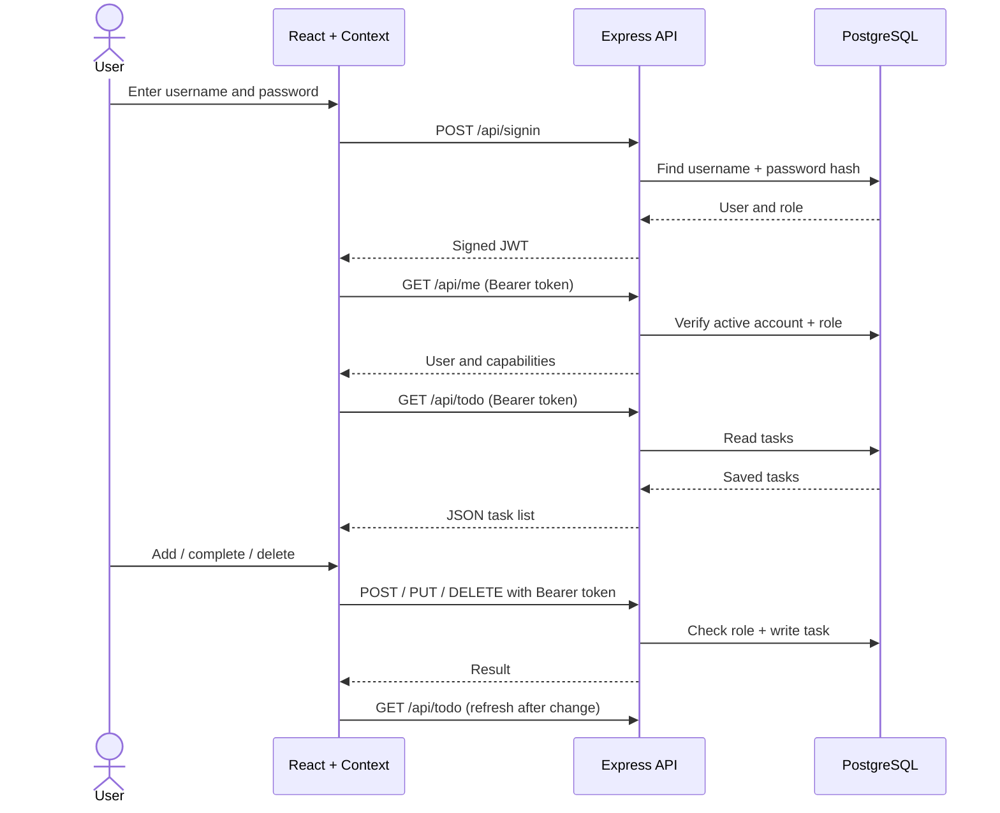

# Daymark Architecture — Code 401 Todo Labs

This guide explains **what each file does**, the React Context relationships, and how client requests reach PostgreSQL. Every source file also contains a top-level description and comments dividing important code blocks.

## Detailed UML: component structure

## HTTP data flow

## File responsibilities

| File | Purpose |
| --- | --- |
| `src/main.jsx` | Mount app, global providers, and Mantine styles |
| `src/App.jsx` | Authentication gate and page routing |
| `src/Context/Settings/Settings.jsx` | Phase 1/2 settings and Local Storage |
| `src/Context/Auth/Auth.jsx` | Phase 3/4 session and capabilities |
| `src/Components/Auth/Auth.jsx` | Hide unauthorized UI actions |
| `src/Components/Login/Login.jsx` | Registration and sign-in form |
| `src/Components/ToDo/ToDo.jsx` | Fetch and mutate tasks through API |
| `src/Components/List/List.jsx` | Filter/sort/paginate task cards |
| `src/Components/SettingsForm/SettingsForm.jsx` | User preference editor |
| `src/Components/Header/Header.jsx` | Navigation and logout |
| `src/Components/Footer/Footer.jsx` | Footer |
| `src/utils/tasks.js` | Pure pagination/sorting/filtering helpers |
| `src/services/api.js` | HTTP requests with Bearer token |
| `src/styles.css` | Responsive styles and visual details |
| `server/src/index.js` | API endpoints and middleware |
| `server/src/db.js` | PostgreSQL pool, tables, optional admin seed |
| `server/src/auth.js` | Server-side JWT validation and ACL |
| `server/src/validation.js` | Input validation |
| `server/src/api.test.js` | Backend ACL and input validation tests |

## Capability matrix

| Role | Read | Create | Update | Delete |
| --- | :---: | :---: | :---: | :---: |
| Reader | ✓ | — | — | — |
| Writer | ✓ | ✓ | — | — |
| Editor (signup default) | ✓ | ✓ | ✓ | — |
| Admin (server-seeded) | ✓ | ✓ | ✓ | ✓ |

**Security note:** A React `<Auth />` component only hides controls. The Express `requireCapability()` middleware performs the actual authorization on every protected endpoint. A signed JWT does not determine ongoing capabilities by itself; the server looks up the current user role each request.

**Cookie note:** To meet the class lab, the client stores the Bearer token in a JavaScript-readable cookie. A hardened production design should use an HttpOnly Secure server-set session cookie (and account for CSRF as appropriate), HTTPS, rotation/revocation, and a stronger overall operational security policy.
